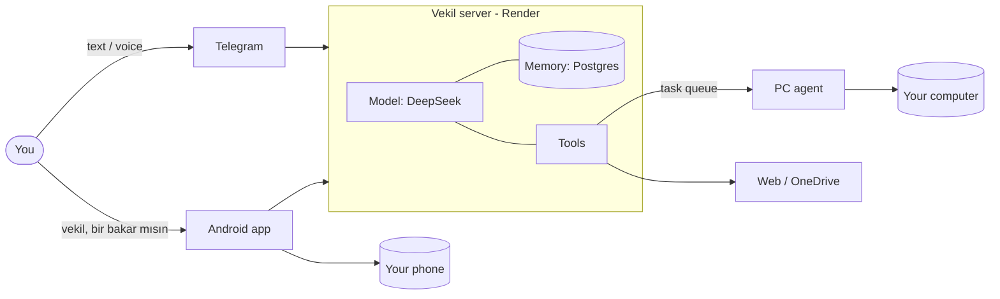

<div align="center">


<a href="https://github.com/osmnabyram/VekilAi">
  
</a>

<br/>


</div>

<p align="center"><a href="README.md">Türkçe</a> &nbsp;|&nbsp; <b>English</b></p>

---

## What is Vekil?

Vekil ("proxy" in Turkish) is a **personal AI assistant that runs on your own server**. You write to it on Telegram or say
"vekil, bir bakar mısın" to your phone; it thinks, uses tools and finishes the job.

It handles files and programs on your computer, sees the screen and uses the mouse and keyboard, opens apps on your phone,
reads messages and sets alarms. No technical knowledge needed: no commands, no menus, just sentences.

> Even for someone who is not comfortable with technology: say what you want, Vekil does the rest.

The assistant talks to its user in Turkish. This page and the code comments are partly Turkish; the setup guide is
available in English ([docs/KURULUM.en.md](docs/KURULUM.en.md)) and Turkish ([docs/KURULUM.md](docs/KURULUM.md)).

## What can it do?

| | |
|---|---|
| **Computer control** | Files, terminal, programs, screenshots; works on its own by looking at the screen and using mouse and keyboard |
| **Phone screen agent** | On Android: open apps, tap, type, read notifications, alarms, flashlight, calls; never touches payment or password fields |
| **Voice assistant** | Always on in the phone, wakes on "vekil bir bakar mısın"; speaks Turkish (recognition: Groq Whisper, voice: Edge TTS) |
| **Persistent memory** | Knows you and learns your preferences; browse memory as a 3D **mind map** |
| **Reminders and briefing** | Timed reminders, to-do list, morning briefing (weather, plan, news), topic follow-up |
| **Self-improvement** | Reviews itself every week and turns ordinary lessons into rules; never touches money or security topics on its own |
| **Internet and files** | Web search, page summaries, OneDrive (rclone), reads Word/Excel/PDF/PowerPoint, understands photos |
| **Phone calls** | Can call you when something important happens (Twilio, optional) |
| **Remote PC wake-up** | A smart plug plus a BIOS setting turns on a powered-off computer; Vekil waits for the agent to connect |
| **Security** | Payments and banking are blocked in code; constant-time tokens, secret masking, rate limits, kill switch ([SECURITY.md](SECURITY.md)) |

## How does it work?



- The **brain** is a small Python server (Starlette + python-telegram-bot). It runs on Render's free plan.
- The **PC agent** is a small script on your computer; it pulls tasks from the server and opens no inbound connection.
- The **Android app** listens for the wake phrase on the device (Vosk) and reads the screen through the accessibility service.

## Quick start

> **Setting it up for someone with no technical background?** Step-by-step guide: [docs/KURULUM.en.md](docs/KURULUM.en.md)

You need: Python 3.12, a Telegram account, a [DeepSeek](https://platform.deepseek.com) API key.

```bash
git clone https://github.com/osmnabyram/VekilAi.git
cd VekilAi
python -m venv .venv && . .venv/bin/activate      # Windows: .venv\Scripts\activate
pip install -r requirements.txt
python kurulum.py                                  # wizard: asks for keys, writes the .env file
python vekil/main.py                               # write on Telegram, Vekil answers
```

The wizard writes `.env`, checks your bot token and finds your chat id itself.
To set up by hand, copy [`.env.example`](.env.example) to `.env` and fill it in.

### Deploy to the cloud (Render)

1. *New → Web Service →* this repo → **Language: Docker** → *Health Check Path* `/health`.
2. Environment: `DEEPSEEK_API_KEY`, `TELEGRAM_BOT_TOKEN`, `TELEGRAM_CHAT_ID`, `WEBHOOK_SECRET`, `AJAN_SECRET`.
3. For persistent memory add a [Neon](https://neon.tech) Postgres URL as `DATABASE_URL` (if empty, temporary SQLite is used).
4. The free plan sleeps the service; set up a monitor (e.g. UptimeRobot) that requests `/health` every 5 minutes.

### PC agent

Copy the `ajan/` folder to your computer, rename `ajan/.env.example` to `.env`, fill in `VEKIL_URL` and
`AJAN_SECRET`, and start it with `python ajan.py`. For screenshots one package is needed: `pip install mss`.

### Android app

**Ready-made APK:** to try it without building, download the signed APK from the [Releases](https://github.com/osmnabyram/VekilAi/releases) page.
To build it yourself, open `android/` in Android Studio or build from the command line. The package name is `com.vekilai.vekil`.

```bash
cd android
python imza_olustur.py          # ONCE: creates the signing key (android/imza/ + keystore.properties)
./gradlew assembleRelease       # signed APK: app/build/outputs/apk/release/app-release.apk
./gradlew assembleDebug         # test APK (release is recommended for sideloading)
```

The APK is distributed as a plain file outside the Play Store; the user allows "install from unknown sources" on the phone.
**Back up the signing key (`android/imza/` and `keystore.properties`) somewhere safe**: updates require the same key, and if
you lose it users must uninstall and reinstall. These files never enter git.

**Customer-specific APK:** `python musteri_apk.py` asks for the customer name, server address and (optionally) the phone key,
embeds them in the APK and produces a signed `cikti/<customer>.apk`; the customer enters nothing on first launch. Give an APK with an embedded key only to that one customer.

Without embedded values, the first launch asks for your server address (https) and phone key (`SESLI_TOKEN`); the key is stored
encrypted with the Keystore. Accessibility and notification access permissions are requested from inside the app.

## Manual setup: required technologies

The wizard checks your keys and writes `.env`, but **you** must create the accounts and tools below.
The last column says which are required.

| Technology | What for | Required? |
|---|---|---|
| Python 3.12 and `pip install -r requirements.txt` | Vekil itself | Yes |
| Telegram account and bot (@BotFather → `/newbot`) | Chatting with Vekil | Yes |
| DeepSeek API account ([platform.deepseek.com](https://platform.deepseek.com)) | Vekil's brain | Yes |
| Render account | Keeping Vekil running while your computer is off (Render builds the Docker image) | If running in the cloud |
| UptimeRobot or similar | Stops the free Render plan from sleeping: a request to `/health` every 5 minutes | If on Render free plan |
| Neon Postgres | Persistent memory (otherwise temporary SQLite) | No |
| Groq account | Voice message transcription | No |
| Tavily account | Web search | No |
| rclone and OneDrive | Cloud file tasks | No |
| PC agent: `ajan/` folder, Python, `pip install mss` | Managing the computer remotely | No |
| Android Studio and JDK | Building the phone app (the Vosk speech model downloads on first launch) | No |
| Twilio | Vekil calling you on the phone | No |

To know where to put keys and addresses, look at the `.env` file: the wizard writes your answers there, and you can add
missing ones by hand using the lines in [`.env.example`](.env.example). On Render, enter the same values in the service's *Environment* section.

## Settings

All settings are environment variables; secrets are never written in code. The main ones:

| Variable | Description |
|---|---|
| `DEEPSEEK_API_KEY`, `DEEPSEEK_MODEL` | Model key and name (default `deepseek-flash`) |
| `TELEGRAM_BOT_TOKEN`, `TELEGRAM_CHAT_ID` | Bot and the single authorized chat |
| `KULLANICI_ADI`, `SEHIR_AD`, `SEHIR_LAT`, `SEHIR_LON` | Briefing greeting and weather city |
| `DATABASE_URL` | Persistent memory (Neon Postgres) |
| `GROQ_API_KEY` | Voice message and phone speech recognition |
| `TAVILY_API_KEY` | Web search |
| `AJAN_SECRET`, `VEKIL_URL` | PC agent identity and server address |
| `KILIT_TUZ`, `KILIT_OZET`, `KILIT_OZET_SADE` | Kill switch (`kys`) password digest; the wizard generates it and the password itself is not stored. If empty, `kys` is off |
| `KILIT_KURTARMA_TUZ`, `KILIT_KURTARMA_OZET` | Password-independent, per-installation recovery code digest (see [SECURITY.md](SECURITY.md)) |
| `SESLI_TOKEN` | Android app key (derived from the bot token if empty; a separate random value is recommended) |
| `TWILIO_*`, `KULLANICI_TELEFON` | Phone calls (optional) |

## Make it yours

Vekil is a **foundation**; add or remove what you need:

- **New tool:** define a `Tool` in [`tools.py`](vekil/tools.py) and wire it into the tool dispatch in [`main.py`](vekil/main.py).
- **Memory seed:** use [`hafiza_tohum.py`](vekil/hafiza_tohum.py) to write what must be known on first start (company info, rules).
- **Briefing plan:** connect your calendar or business system with `brifing.Brifing(plan_kaynagi=...)`.
- **Address and identity:** the system prompts are in `main.py`, `arama.py` and `telefon_ajan.py`.

## Security

Vekil manages your computer and phone, so security is a core design goal: payments and banking are rejected in code,
all endpoints are protected by constant-time keys, secrets are masked in logs, and the kill switch (`kys`) locks everything.
Details and how to report a vulnerability: [SECURITY.md](SECURITY.md).

## Development

```bash
python -m unittest discover -s tests -t . -q       # tests (no real keys needed)
```

The code uses Turkish naming. Architecture map and developer notes: [CLAUDE.md](CLAUDE.md).

## License and author

[MIT](LICENSE) © 2026 **Osman Bayram** · [github.com/osmnabyram](https://github.com/osmnabyram)

<div align="center"></div>
