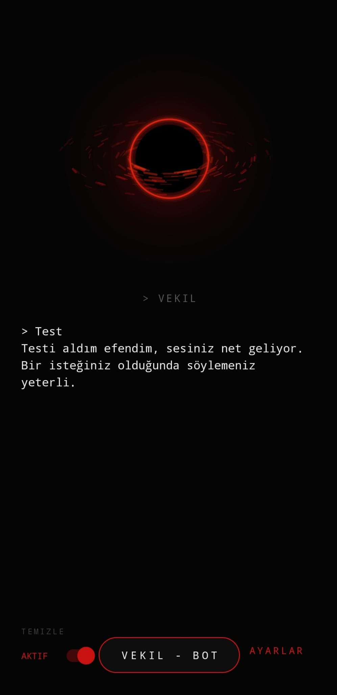
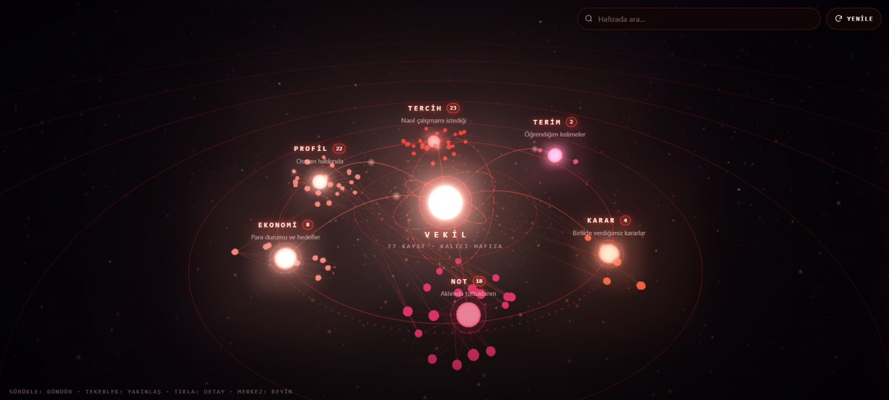
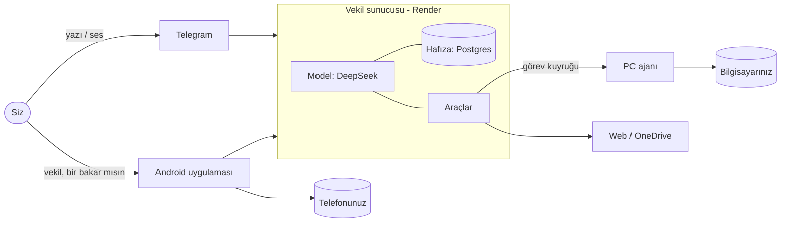

<div align="center">


<a href="https://github.com/osmnabyram/VekilAi">
  
</a>

<br/>


</div>

<p align="center"><b>Türkçe</b> &nbsp;|&nbsp; <a href="README.en.md">English</a></p>

---

## Vekil nedir?

Vekil, kendi sunucunuzda çalışan **kişisel yapay zeka asistanıdır**. Telegram'dan yazarsınız ya da telefona
"vekil, bir bakar mısın" diye seslenirsiniz; Vekil düşünür, araç kullanır ve işi bitirir.

Bilgisayarınızda dosya ve program işlerini yapar, ekranı görüp fareyi ve klavyeyi kullanır, telefonunuzda
uygulama açar, mesaj okur, alarm kurar. Teknik bilgi gerekmez: komut yok, menü yok, sadece cümle.

> Teknolojiyle arası iyi olmayan biri için bile: ne istediğinizi söylersiniz, gerisini Vekil yapar.

## Neler yapar?

| | |
|---|---|
| **Bilgisayar kontrolü** | Dosya, terminal, program, ekran görüntüsü; ekranı görerek fare ve klavyeyle kendi kendine iş yapma |
| **Telefon ekran ajanı** | Android'de uygulama açma, tıklama, yazma, bildirim okuma, alarm, fener, arama; ödeme ve şifre alanlarına dokunmaz |
| **Sesli asistan** | Telefonda hep açık, "vekil bir bakar mısın" ile uyanır; Türkçe konuşur (tanıma Groq Whisper, ses Edge TTS) |
| **Kalıcı hafıza** | Sizi tanır, tercihlerinizi öğrenir; 3B **zihin haritası** ile hafızaya göz atın |
| **Hatırlatma ve brifing** | Saatli hatırlatmalar, yapılacaklar, sabah brifingi (hava, plan, haberler), konu takibi |
| **Kendi kendine öğrenme** | Her hafta kendini değerlendirir, sıradan dersleri kurala çevirir; para ve güvenlik konularına kendiliğinden dokunmaz |
| **İnternet ve dosyalar** | Web arama, sayfa özeti, OneDrive (rclone), Word/Excel/PDF/PowerPoint okuma, fotoğraf anlama |
| **Telefonla arama** | Önemli bir şey olduğunda sizi arayabilir (Twilio, isteğe bağlı) |
| **Uzaktan PC uyandırma** | Akıllı priz ve BIOS ayarıyla kapalı bilgisayar açılır, Vekil ajanın bağlanmasını bekler |
| **Yönetim sayfası** | Telegram'da `/yonetim`: durum, hafıza sayıları, PC ajanı, son işler (konuşma metni göstermez) |
| **Güvenlik** | Ödeme ve banka işlemleri kodda engellenir; sabit zamanlı token, sır maskeleme, hız sınırı, kill switch ([SECURITY.md](SECURITY.md)) |

## Görünüm

<p align="center"></p>

<p align="center"><br/><sub>3B zihin haritası: hafızadaki her kayıt, türüne göre bir gezegenin çevresinde durur.</sub></p>

## Nasıl çalışır?



- **Beyin**, küçük bir Python sunucusudur (Starlette + python-telegram-bot). Ücretsiz Render planında çalışır.
- **PC ajanı**, bilgisayarınızda çalışan küçük bir betiktir; görevleri sunucudan çeker, dışarıdan bağlantı açmaz.
- **Android uygulaması** uyanma kelimesini cihaz üzerinde dinler (Vosk), ekranı erişilebilirlik servisiyle okur.

## Hızlı başlangıç

> **Hiç teknik bilgisi olmayan birine kuruyorsanız:** sıfırdan sona adım adım rehber → [docs/KURULUM.md](docs/KURULUM.md)

Gerekenler: Python 3.12, bir Telegram hesabı, bir [DeepSeek](https://platform.deepseek.com) anahtarı.

```bash
git clone https://github.com/osmnabyram/VekilAi.git
cd VekilAi
python -m venv .venv && . .venv/bin/activate      # Windows: .venv\Scripts\activate
pip install -r requirements.txt
python kurulum.py                                  # sihirbaz: anahtarları sorar, .env dosyasını yazar
python vekil/main.py                                     # Telegram'dan yazın, Vekil cevap verir
```

Sihirbaz `.env` dosyasını oluşturur, bot anahtarınızı doğrular ve sohbet kimliğinizi kendisi bulur.
Elle kurmak isterseniz [`.env.example`](.env.example) dosyasını `.env` olarak kopyalayıp doldurun.

### Buluta almak (Render)

[](https://render.com/deploy?repo=https://github.com/osmnabyram/VekilAi)

Düğme `render.yaml` dosyasını okur ve servisi hazırlar; formda `DEEPSEEK_API_KEY`, `TELEGRAM_BOT_TOKEN`, `TELEGRAM_CHAT_ID` ve (önerilir) `DATABASE_URL` sorulur. Rastgele anahtarları Render kendisi üretir. Elle kurmak isterseniz:

1. *New → Web Service →* bu depo → **Language: Docker** → *Health Check Path* `/health`.
2. Environment: `DEEPSEEK_API_KEY`, `TELEGRAM_BOT_TOKEN`, `TELEGRAM_CHAT_ID`, `WEBHOOK_SECRET`, `AJAN_SECRET`.
3. Kalıcı hafıza için [Neon](https://neon.tech) Postgres adresini `DATABASE_URL` olarak ekleyin (boşsa geçici SQLite).
4. Ücretsiz planda servis uyur; `/health` adresine 5 dakikada bir istek atan bir izleyici (ör. UptimeRobot) kurun.

### PC ajanı

`ajan/` klasörünü bilgisayarınıza kopyalayın, `ajan/.env.example` dosyasını `.env` yapıp `VEKIL_URL` ve
`AJAN_SECRET` değerlerini yazın, `python ajan.py` ile başlatın. Ekran görüntüsü için tek paket: `pip install mss`.

### Android uygulaması

**Hazır APK:** derlemeden denemek isterseniz [Releases](https://github.com/osmnabyram/VekilAi/releases) sayfasından imzalı APK'yı indirin.
Kendiniz derlemek için `android/` klasörünü Android Studio ile açın ya da komut satırından derleyin. Paket adı `com.vekilai.vekil`.

```bash
cd android
python imza_olustur.py          # BİR KEZ: imza anahtarını üretir (android/imza/ + keystore.properties)
./gradlew assembleRelease       # imzalı APK: app/build/outputs/apk/release/app-release.apk
./gradlew assembleDebug         # deneme APK'sı (Play Store dışı kurulum için release önerilir)
```

APK Play Store dışında, doğrudan dosya olarak dağıtılır; kullanıcı telefonda "bilinmeyen kaynaktan kurulum" iznini verir.
**İmza anahtarını (`android/imza/` ve `keystore.properties`) güvenli bir yere yedekleyin**: güncellemeler aynı anahtarı ister,
kaybederseniz kullanıcılar uygulamayı silip baştan kurmak zorunda kalır. Bu dosyalar git'e girmez.

**Müşteriye özel APK:** `python musteri_apk.py` müşteri adını, sunucu adresini ve (isterseniz) telefon anahtarını sorar,
bunları APK'ya gömüp imzalı `cikti/<musteri>.apk` üretir; müşteri açınca hiçbir şey girmez. Anahtar gömülü APK'yı yalnızca o müşteriye verin.

Gömülü değer yoksa ilk açılışta sunucu adresiniz (https) ve telefon anahtarınız (`SESLI_TOKEN`) girilir; anahtar telefonda Keystore ile
şifreli saklanır. Erişilebilirlik ve bildirim erişimi izinleri uygulama içinden istenir.

## Elle kurulum: gerekli teknolojiler

Kurulum sihirbazı anahtarlarınızı doğrular ve `.env` dosyasını yazar; ama aşağıdaki hesapları ve araçları **sizin**
kurmanız gerekir. Hangilerinin zorunlu olduğu yanında yazıyor.

| Teknoloji | Ne için | Zorunlu mu? |
|---|---|---|
| Python 3.12 ve `pip install -r requirements.txt` | Vekil'in kendisi | Evet |
| Telegram hesabı ve bot (@BotFather → `/newbot`) | Vekil ile yazışma | Evet |
| DeepSeek API hesabı ([platform.deepseek.com](https://platform.deepseek.com)) | Vekil'in beyni | Evet |
| Render hesabı | Vekil'i bilgisayarınız kapalıyken de çalıştırmak (Docker imajını Render derler) | Bulutta çalıştıracaksanız |
| UptimeRobot ya da benzeri | Ücretsiz Render planında uyumasın diye `/health` adresine 5 dakikada bir istek | Render ücretsiz plandaysa |
| Neon Postgres | Kalıcı hafıza (yoksa geçici SQLite kullanılır) | Hayır |
| Groq hesabı | Sesli mesajları yazıya çevirme | Hayır |
| Tavily hesabı | İnternette arama | Hayır |
| rclone ve OneDrive | Bulut dosya işleri | Hayır |
| PC ajanı: `ajan/` klasörü, Python, `pip install mss` | Bilgisayarı uzaktan yönetmek | Hayır |
| Android Studio ve JDK | Telefon uygulamasını derlemek (Vosk ses modeli ilk açılışta iner) | Hayır |
| Twilio | Vekil'in sizi telefonla araması | Hayır |

Hesapların anahtarlarını ve adreslerini nereye yazacağınızı bilmek için `.env` dosyasına bakın: sihirbaz
girdiğiniz bilgileri oraya yazar, eksik olanları [`.env.example`](.env.example) içindeki satırlarla
elle ekleyebilirsiniz. Render'da aynı değerleri servisin *Environment* bölümüne girin.

## Ayarlar

Hepsi ortam değişkenidir; gizli değerler koda yazılmaz. Başlıcaları:

| Değişken | Açıklama |
|---|---|
| `DEEPSEEK_API_KEY`, `DEEPSEEK_MODEL` | Model anahtarı ve adı (varsayılan `deepseek-flash`) |
| `TELEGRAM_BOT_TOKEN`, `TELEGRAM_CHAT_ID` | Bot ve tek yetkili sohbet |
| `KULLANICI_ADI`, `SEHIR_AD`, `SEHIR_LAT`, `SEHIR_LON` | Brifing selamı ve hava durumu şehri |
| `DIL` | Asistanın dili: `tr` (varsayılan) ya da `en`. `en` iken cevaplar, sesli okuma ve konuşma tanıma İngilizce olur; `/durum` gibi yerleşik komut mesajları Türkçe kalır |
| `DATABASE_URL` | Kalıcı hafıza (Neon Postgres) |
| `GROQ_API_KEY` | Sesli mesaj ve telefon konuşma tanıma |
| `TAVILY_API_KEY` | Web arama |
| `AJAN_SECRET`, `VEKIL_URL` | PC ajanı kimliği ve sunucu adresi |
| `KILIT_TUZ`, `KILIT_OZET`, `KILIT_OZET_SADE` | Kill switch (`kys`) şifre özeti; sihirbaz üretir, şifrenin kendisi saklanmaz. Boşsa `kys` kapalıdır |
| `KILIT_KURTARMA_TUZ`, `KILIT_KURTARMA_OZET` | Şifreden bağımsız, o kuruluma özel kurtarma kodu özeti (bkz. [SECURITY.md](SECURITY.md)) |
| `SESLI_TOKEN` | Android uygulaması anahtarı (boşsa bot anahtarından türetilir; ayrı rastgele değer önerilir) |
| `TWILIO_*`, `KULLANICI_TELEFON` | Telefonla arama (isteğe bağlı) |

## Kendinize göre şekillendirin

Vekil bir **temeldir**; ihtiyacınıza göre ekleyin ya da çıkarın:

- **Yeni araç (önerilen):** [`eklentiler/`](eklentiler/README.md) klasörüne bir `.py` dosyası koyun; ana koda dokunmadan yüklenir. Şablon: [`eklentiler/_ornek.py`](eklentiler/_ornek.py).
- **Yeni yerleşik araç:** [`tools.py`](vekil/tools.py) içine bir `Tool` tanımlayın, [`main.py`](vekil/main.py) içindeki araç dağıtımına bağlayın.
- **Hafıza başlangıcı:** [`hafiza_tohum.py`](vekil/hafiza_tohum.py) ile ilk açılışta bilinmesi gerekenleri yazın (şirket bilgisi, kurallar).
- **Brifing planı:** `brifing.Brifing(plan_kaynagi=...)` ile takvim ya da iş sisteminizi bağlayın.
- **Hitap ve kimlik:** sistem istemleri `main.py`, `arama.py` ve `telefon_ajan.py` içindedir.

## Güvenlik

Vekil bilgisayarınızı ve telefonunuzu yönettiği için güvenlik temel tasarımdır: ödeme ve banka işlemleri
kodda reddedilir, tüm uçlar sabit zamanlı anahtarla korunur, loglarda sırlar maskelenir, kill switch
(`kys`) her şeyi kilitler. Ayrıntılar ve açık bildirimi: [SECURITY.md](SECURITY.md).

## Geliştirme

```bash
python -m unittest discover -s tests -t . -q       # testler (gerçek anahtar gerekmez)
```

Sık sorulanlar: [docs/SSS.md](docs/SSS.md) · Veri ve gizlilik: [docs/GIZLILIK.md](docs/GIZLILIK.md) · [Yol haritası](ROADMAP.md) · [Değişiklikler](CHANGELOG.md)

Kod Türkçe adlandırılmıştır. Mimari harita ve geliştirici notları: [CLAUDE.md](CLAUDE.md).

## Lisans ve yazar

[MIT](LICENSE) © 2026 **Osman Bayram** · [github.com/osmnabyram](https://github.com/osmnabyram)

<div align="center"></div>
